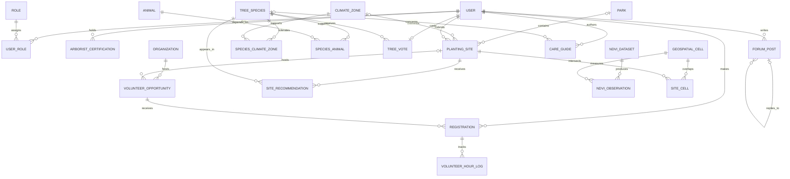
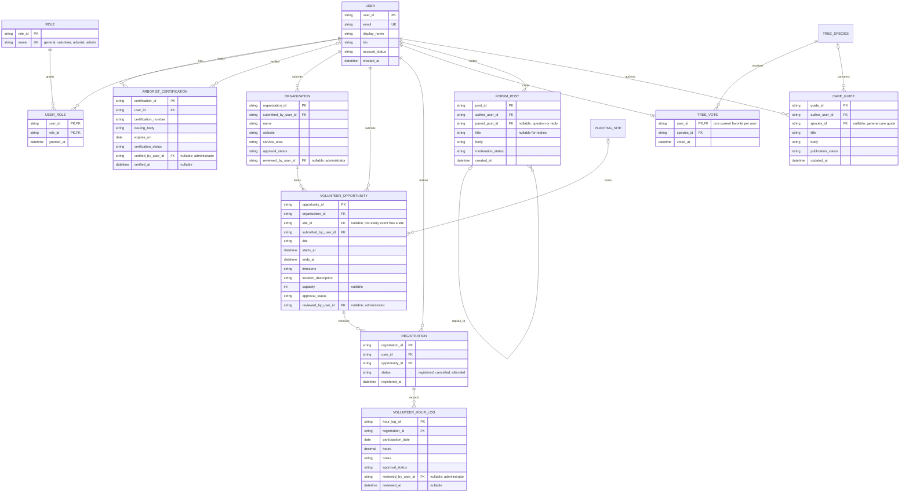
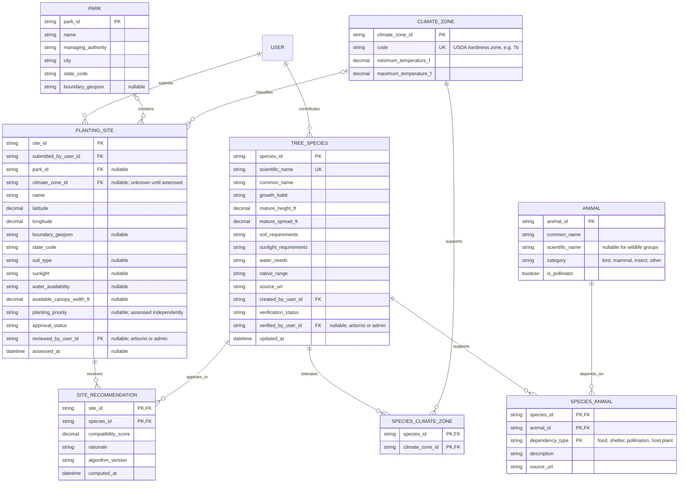
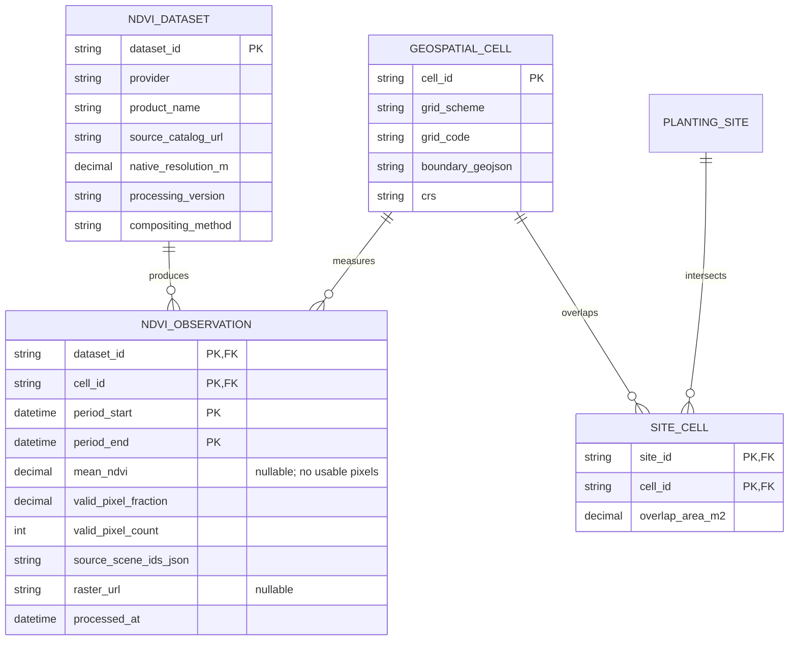

# Treefinder ER diagram

This is the proposed normalized logical data model for the complete Treefinder system, including nationwide vegetation intelligence. It is a design artifact, not a migration of the running app. The current implementation uses `profiles`, `records`, `registrations`, and `votes`; content such as sites, events, guides, and hours currently lives in typed JSON records.

General users, volunteers, certified arborists, and administrators share one user identity. Roles represent permissions; a person can hold more than one role. Arborist certifications have their own verification lifecycle. The current app uses one role per profile; multiple roles are a proposed extension.

## Overview

## Identity, volunteering, and community

## Species, wildlife, and planting sites

## Nationwide satellite intelligence

The NDVI tables are proposed storage for future numeric satellite processing. Today's NASA map tiles are visual imagery, and Sentinel-2 discovery returns source scene metadata; neither currently populates these tables. Keep source resolution, composite dates, and usable-pixel coverage with every measurement. Missing imagery must remain unknown rather than receiving a zero score. NDVI describes vegetation greenness and must not automatically determine site approval, tree canopy, or plantability.

## Cardinality and constraints

- `||` = exactly one; `o|` or `|o` = zero or one; `o{` = zero or many. `PK` identifies a primary key, `FK` a foreign key, and `UK` a unique key. Multiple `PK` fields form a composite key.
- Every registration belongs to one user and one opportunity. Enforce uniqueness on `(user_id, opportunity_id)`; cancellation updates its status instead of creating another registration.
- Each hour log belongs to a registration, which already identifies both the volunteer and event. Sum approved logs to calculate verified participation hours. Validate positive hours, event dates, and prevent duplicate claims through review.
- A user can have at most one current favorite-tree vote. Changing the favorite updates that row.
- Species-to-zone, species-to-animal, site-to-species, and site-to-grid-cell relationships use junction tables for many-to-many associations.
- Sites may be outside parks and may have unknown growing conditions. Events may be held at a location that has no planting-site record.
- Approvals belong to their subject records. Nullable reviewer foreign keys point to `USER`; authorization checks restrict organization, opportunity, certification, and hour approvals to administrators, and species/site review to authorized arborists or administrators.
- Forum replies point to a parent post. Prevent parent cycles and orphan replies. A verified-arborist badge derives from the author's verified, unexpired certification and authorized role; users cannot set it themselves.
- Recommendations record the assessment method and time. They guide species exploration and require local review before planting.
- Treat geometry representation and spatial indexes as implementation choices. This logical model does not assume a spatial database extension is available in the current Cloudflare D1 deployment.
